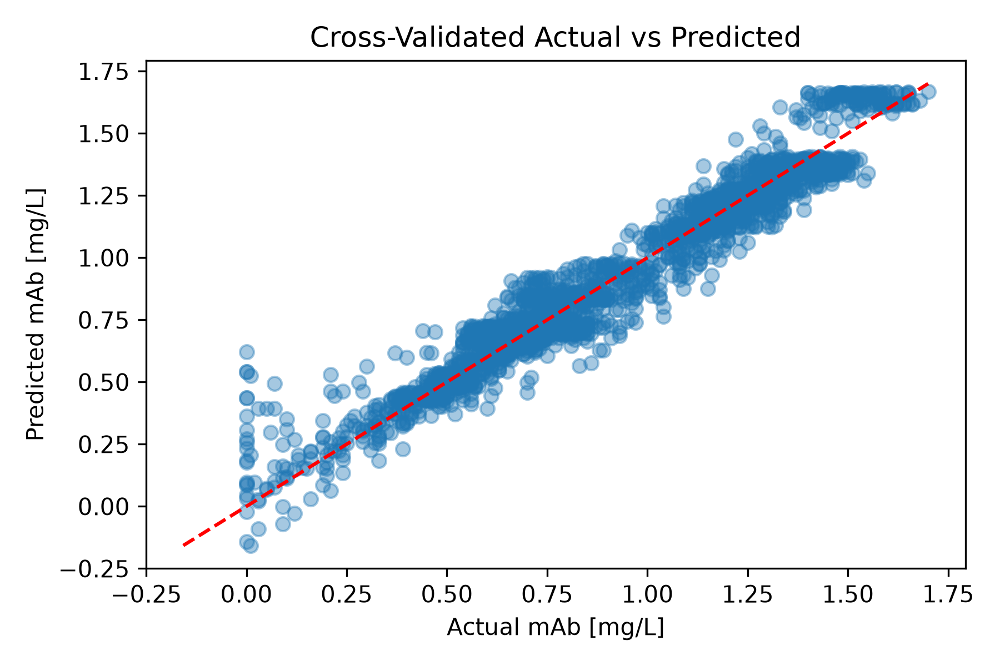
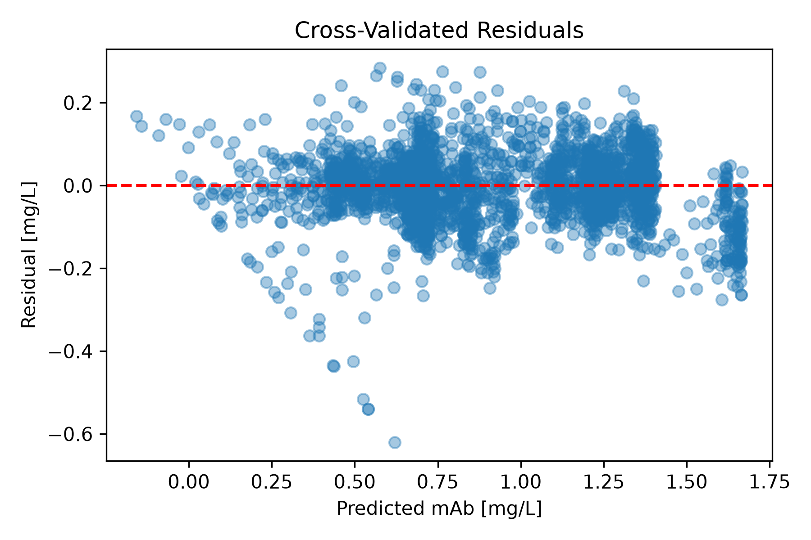
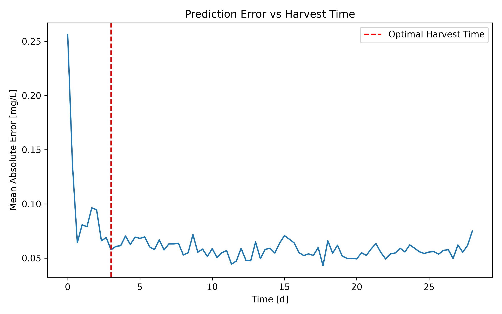
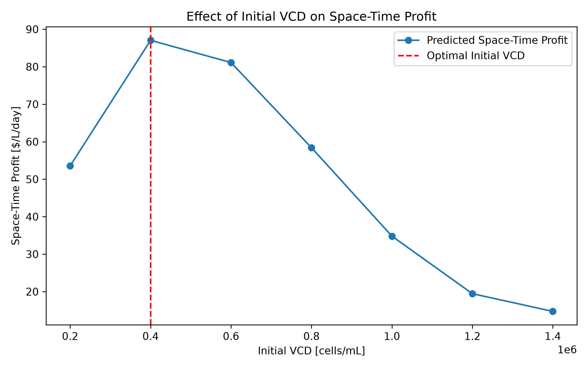
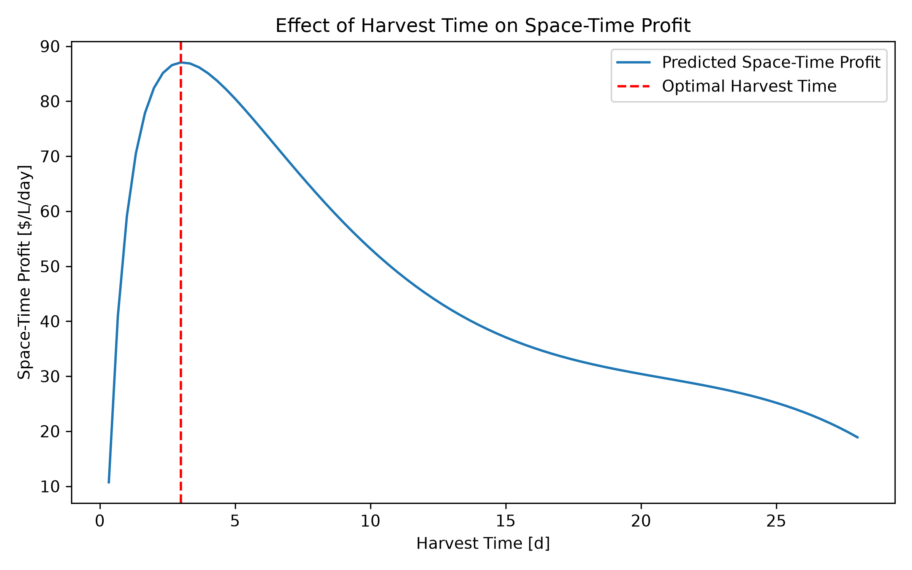
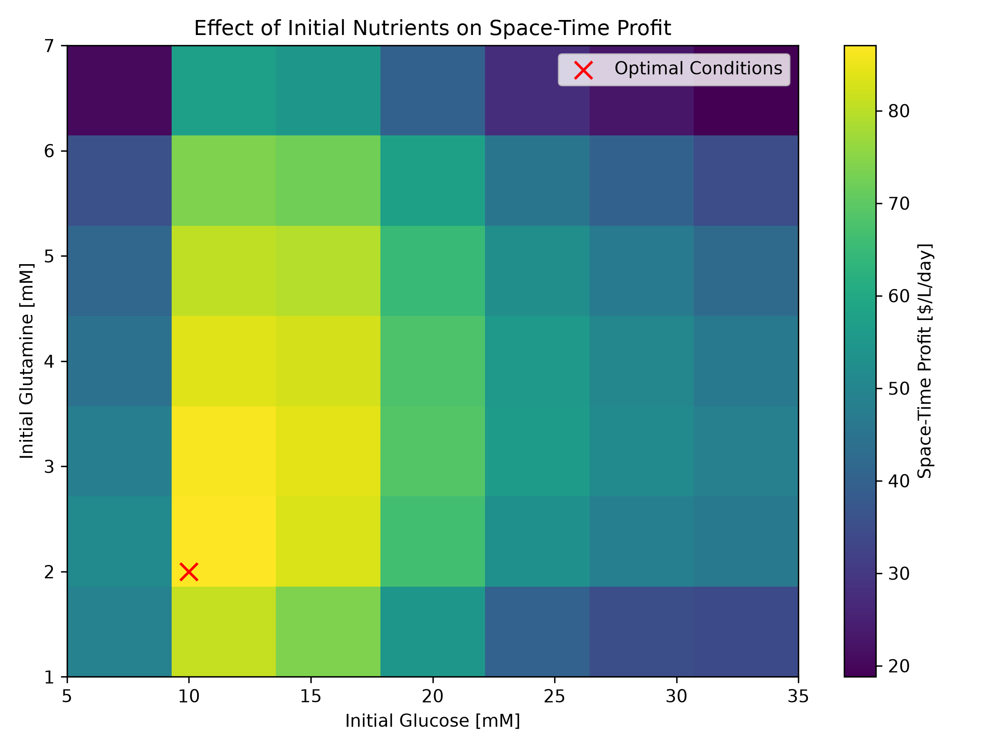

# Monoclonal Antibody Production Optimization
This Python project is designed to maximize the space-time profit of a monoclonal antibody production process. 
There are 1029 available batch runs, representing 7 initial conditions for each glucose, glutamine, and initial viable cell density (VCD), each with three replicates. The project aims to predict and analyze the data in order to determine the initial conditions that will maximize the space-time profit of the mAb production process.
  
## Highlights
- Selects 30 representative batch runs from 1029 available cultures using a space-filling experimental design.
- Implements and compares polynomial regression and k-nearest neighbors regression models.
- Predicts monoclonal antibody concentration as a function of operating conditions and harvest time. 
- Identifies operating conditions that maximize space-time profit and space-time yield.
- Generates automated figures and summary tables for model evaluation and optimization. 

## Environment
- Python 3.14.7
- matplotlib 3.11.0
- numpy 2.5.2
- Pandas 3.0.5
- scikit-learn 1.9.0

## Code Design
### Initialize Settings and Data Extraction
The workflow begins by importing the required Python packages for data handling, machine learning, optimization, and visualization. 
The initial conditions dataset is then loaded, which establishes the relationship between batch identifiers and their corresponding initial glucose, glutamine, and VCD values. This dataset serves as the reference for selecting batches and associating initial operating conditions with their time-series measurements. Individual batch time-series files are accessed later in the workflow.
### Batch Selection and Extraction
Once the data has been loaded, the 1029 available batch runs are filtered to select 30 runs that will be representative of the operating space. This is achieved by first defining low, medium, and high levels for glucose, glutamine, and VCD. One batch is selected for each of the 27 possible combinations of these levels, providing coverage across the operating space. Three additional centerpoint replicates are included to provide repeated observations at the central operating conditions.
The code verifies that exactly 30 unique batches are selected, and loads the time-series data. Each individual time-series trajectory is then read and combined into a single Pandas DataFrame, allowing the experimental runs to be processed and analyzed collectively.
 ### Data Preparation and Feature Engineering
The workflow then associates each batch trajectory with the corresponding initial conditions, and merges glucose, glutamine, and VCD initialization data into the time-series dataset. This creates a unified dataset that contains both time-dependent measurements and batch-level operating conditions. 
The feature engineering stage then prepares the data for model development and economic analysis. The machine learning model uses initial glucose concentration, initial glutamine concentration, initial VCD, and cultivation time as input features, with mAb concentration as the prediction target. Cultivation time is also converted from hours to days. Additional economic metrics are calculated separately using the predicted mAb concentration and the initial operating conditions, allowing model predictions to be translated into process profitability and production efficiency.
### Machine Learning Model Development
The mAb concentration is dependent on how the cells grow and produce antibodies over time, which can involve nonlinear interactions between the operating variables. The purpose of the machine learning stage is to develop a model that can predict mAb concentration from the operating conditions and harvest time. This surrogate model can be trained and used to evaluate operating conditions that were not directly included in the selected training batches. 
The workflow explores several candidate regression models, including polynomial regression models of degrees varying from 1, being a simple linear regression, to 4. K-nearest neighbors regression is also implemented. For each model, the hyperparameters are optimized using cross-validation.
### Model Validation and Selection
The model validation and selection stage exists to assess the predictive performance of each proposed model using five-fold grouped cross-validation. The data are grouped according to their initial operating conditions to prevent observations from the same operating-condition group from being distributed between the training and validation datasets. This provides a more meaningful assessment of the model's ability to predict mAb concentrations under operating conditions not directly represented in the training data. 
The root mean square error (RMSE) and coefficient of determination (R²) are used to compare model performance. In addition to these values, residuals are analyzed to identify prediction errors, trends, and potential biases. The model with the lowest prediction error and strongest overall agreement with the measured data was selected for the optimization stage.
### Early-Time Prediction Assessment
The optimization results depend on the model's ability to predict mAb concentration throughout the cultivation period, including early harvest time. 
This workflow stage therefore performs additional analyses to compare unconstrained and physically constrained polynomial models and quantify prediction error during the early stages of cultivation. This analysis helps determine whether the model remains reasonable during the early stages of cultivation, where the measured mAb concentrations are still very low.
### Process Optimization
Once a predictive model is selected, the process optimization stage evaluates operating conditions that were not included in the training set. A search space covering all combinations of glucose concentration, glutamine concentration, viable cell density, and harvest time is evaluated, and the predicted mAb concentrations are then used to identify operating conditions that maximize space-time profit.
### Uncertainty and Sensitivity Analysis   
Since the optimization results are based on model predictions rather than direct measurements, additional analyses are performed to assess the robustness of the recommended operating conditions. Residuals from the cross-validation procedure are used to estimate prediction uncertainty and generate approximate prediction intervals for the recommended operating conditions. Sensitivity analyses are also performed to examine how harvest time, nutrient concentrations, and viable cell density influence process profitability and productivity. These analyses help identify whether the recommended operating strategy remains optimal when model uncertainty is considered.
### Visualization and Reporting
The final stage of the workflow generates plots, optimization figures, sensitivity analyses, and summary tables. These outputs provide a basis for evaluating model performance, interpreting optimization results, and communicating findings. 
All outputs are exported to the "tables" and "figures" folders of the repository. 
 
## Analysis
### Experimental Design
The available dataset contained 1029 batch runs, consisting of three replicates for each of the 343 combinations of initial glucose concentration, glutamine concentration, and VCD. To reduce the computational requirements of the analysis, a smaller subset of 30 batches was selected. To provide adequate coverage of the operating space, one batch was selected for each of the 27 possible combinations of low, medium, and high initial conditions across the three operating variables. Three additional centerpoint batches were included to provide repeated observations at intermediate conditions and allow variability at the centerpoint to be assessed.

Although reducing the dataset makes the analysis more computationally manageable, it also means that the model is trained on a smaller subset of the available experimental data. Additionally, selecting batches based on low, medium, and high initial conditions provides coverage across the operating space, but does not necessarily ensure uniform representation of every possible combination within the continuous range of operating conditions.

Although some operating conditions were excluded from the training set, this approach allowed the model to be trained on a manageable number of batches while still covering the full operating range.
### Model Development and Selection
The table below compares the predictive performance of the polynomial models and KNN regression using cross-validation RMSE and R². 

|Model                |Degree|Neighbors (k)|Weights |CV RMSE [mg/L]|CV R² |
|---------------------|------|-------------|--------|--------------|------|
|Polynomial Regression|4     |—            |—       |0.0834        |0.9418|
|Polynomial Regression|3     |—            |—       |0.0932        |0.9307|
|Polynomial Regression|2     |—            |—       |0.1193        |0.8888|
|KNN Regression       |—     |20           |uniform |0.1735        |0.7178|
|KNN Regression       |—     |20           |distance|0.1736        |0.7172|
|KNN Regression       |—     |10           |distance|0.1960        |0.6422|
|KNN Regression       |—     |10           |uniform |0.1960        |0.6421|
|KNN Regression       |—     |3            |uniform |0.1995        |0.6142|
|KNN Regression       |—     |3            |distance|0.1995        |0.6142|
|KNN Regression       |—     |5            |uniform |0.1998        |0.6126|
|KNN Regression       |—     |5            |distance|0.1998        |0.6127|
|Polynomial Regression|1     |—            |—       |0.2206        |0.6011|

Among the candidate models, KNN regression with varying values of k performs considerably worse than the polynomial models. This suggests that estimating the response using nearby observations is less effective at capturing the underlying process relationship, and a polynomial model may be more appropriate for the dataset.
When comparing the polynomial models, increasing polynomial degree substantially improves predictive performance. This suggests that the relationship between initial operating conditions, cultivation time, and mAb production is not adequately represented by a simple linear model. Among the evaluated models, degree four polynomial model achieved the lowest cross-validated RMSE (0.0834 mg/L) and highest R² (0.9418) of the candidate models.
However, the improvement between degrees three and four is minimal, suggesting diminishing returns from increasing model complexity. Higher polynomial degrees can also introduce overfitting and unstable extrapolation. The cross-validation results suggest that the degree-four model offers the best predictive performance, although some risk of overfitting remains because of the increased model complexity. Despite this possibility, the degree-four polynomial model was selected for further analysis because it provided the best overall cross-validation performance.

The figures below show the actual versus predicted values and the corresponding residuals for the selected model.

The actual-versus-predicted plot shows that most predictions are reasonably close to the 1:1 line, indicating good agreement between the predicted and measured mAb concentrations. However, there is noticeably more scatter at lower actual concentrations, where the model appears to overpredict several observations. Some deviations are also present at higher concentrations, suggesting that the model does not predict mAb concentrations equally well across the entire range. Despite these differences, the overall agreement between the predicted and measured values supports the high cross-validated R² obtained for the degree-four polynomial model.
The residual plot provides a closer look at these prediction errors. Most residuals are distributed around zero, suggesting that the model does not exhibit a strong overall tendency to overpredict or underpredict. However, several relatively large errors are still present, particularly at intermediate predicted mAb concentrations. The residuals also appear somewhat clustered, with their spread varying across the prediction range. This suggests that the model's accuracy depends to some extent on the concentration being predicted. Overall, while the degree-four polynomial model provides good predictive performance, there are still some regions where its predictions are less reliable.

The figure below shows the prediction error versus cultivation time. 

The prediction error versus time plot shows that the model substantially overpredicts mAb concentrations at time zero, despite the actual initial concentration of mAb being zero. By 16 hours, the mean absolute error decreases from approximately 0.256 mg/L at time zero to 0.064 mg/L, indicating a considerable improvement in prediction accuracy over time. These results suggest that the model is less reliable at the early stages of cultivation, which is particularly important when evaluating shorter harvest times.
In order to address these physically unrealistic predictions at time zero, a constrained polynomial model was also investigated. This model was designed to enforce a predicated mAb concentration of zero at the beginning of cultivation. However, its overall predictive performance was worse than that of the unconstrained four-degree model. As a result, the unconstrained model was selected for optimization, with the negative predicted mAb concentrations clipped to zero before calculating the economic performance metrics.

### Operating Condition Effects

The effect of initial VCD on space-time profit is shown in the figure above. Space-time profit increases substantially as the initial VCD increases from 200,000 to 400,000 cells/mL, reaching a maximum of approximately 87/L/day. However, after this point, increases in initial VCD result in a decline in profitability. At the highest analyzed VCD of 1.4 million cells/mL, space-time profit decreases to 15/L/day.
This trend reflects the relationship between initial culture costs and the value of the harvested product. While increasing the initial VCD can improve mAb production and therefore the value of the batch, it also increases culture costs. Beyond 400,000 cells/mL, the additional cost and predicted production response result in lower overall profitability. Therefore, 400,000 cells/mL represents the most profitable initial VCD among the investigated conditions.

The figure above shows the effect of harvest time on space-time profit. During the initial cultivation period, profitability increases rapidly before reaching a maximum at around 3 days. After this point, profitability gradually decreases.
This decrease is related to the additional time required to complete each batch. While extending the cultivation period can increase the total value of the harvested product, it also increases the overall batch cycle time. Since space-time profit accounts for both batch profit and cycle duration, the additional mAb produced during longer cultivation periods does not provide enough additional value to maintain the same level of profitability. The one-day downtime between batches also contributes to the total cycle time and is therefore included in this calculation. The maximum at 72 hours represents the point at which the balance between product accumulation and batch duration results in the highest space-time profit.
It is important to consider the model's prediction accuracy when interpreting the results at shorter harvest times. As discussed previously, the model tends to overpredict mAb concentrations during the early stages of cultivation, particularly at time zero. Therefore, the predicted profitability at very short harvest times may be less reliable. This is especially relevant when comparing space-time profit with space-time yield, which is maximized at the earliest evaluated harvest time. This difference demonstrates that the conditions producing the highest amount of mAb per unit time do not necessarily provide the greatest economic return.

### Process Optimization
The final optimization was performed by evaluating 28,812 combinations of initial glucose, initial glutamine, initial VCD, and harvest time. The objective was to maximize space-time profit while accounting for both the initial cell culture costs and the value of the harvested mAb.

The heatmap below shows the effect of initial glucose and glutamine concentrations on space-time profit, with the remaining operating conditions held at their optimal values.

The highest profitability occurs at relatively low initial nutrient concentrations, with the optimal conditions corresponding to 10 mM glucose and 2 mM glutamine. Although several nearby combinations also provide relatively high space-time profit, increasing either nutrient concentration beyond the optimal conditions generally results in lower profitability. This is consistent with the additional culture costs associated with increasing the initial nutrient concentrations. In particular, glutamine has a higher cost contribution than glucose, at $20/L per mM compared to $10/L per mM, making increases in glutamine concentration more expensive.

The optimal operating conditions and corresponding predicted performance are summarized below.

|Optimization Objective |Initial Glucose [mM]|Initial Glutamine [mM]|Initial VCD [cells/mL]|Time [h]|Time [d]|Raw Predicted mAb [mg/L]|Predicted mAb [mg/L]|Cell Culture Cost [$/L]|Predicted Cell Culture Value [$/L]|Predicted Profit [$/L]|Predicted Space-Time Profit [$/L/d]|Predicted Space-Time Yield [mg/L/d]|
|-----------------------|--------------------|----------------------|----------------------|--------|--------|------------------------|--------------------|-----------------------|----------------------------------|----------------------|-----------------------------------|-----------------------------------|
|Profit Optimum         |10.0                |2.0                   |400000.0              |72.0    |3.0     |0.6882                  |0.6882              |340.0                  |688.21                            |348.21                |87.05                              |0.1721                             |
|Yield Optimum          |15.0                |6.0                   |1400000.0             |8.0     |0.33    |0.6583                  |0.6583              |970.0                  |658.3339                          |-311.6661             |-233.75                            |0.4938                             |

The optimal conditions reflect the combined effects of nutrient costs, initial cell concentration, and cultivation time. As discussed previously, increasing initial VCD beyond 400,000 cells/mL reduces profitability, while higher initial glucose and glutamine concentrations do not provide sufficient additional product value to justify their increased costs. A harvest time of 72 hours provides the best balance between mAb accumulation and batch cycle duration. Together, these conditions produce the highest predicted space-time profit within the evaluated operating range.
It is important to note that the optimal operating conditions were obtained through interpolation within the operating space rather than direct observation of a training batch. Therefore, the machine-learning model predicts that intermediate nutrient concentrations provide a more favourable balance between production and culture costs than the low, medium, and high conditions used during model training. Experimental validation would be required to confirm this prediction.
It is also useful to compare the conditions that maximize space-time profit with those that maximize space-time yield. The yield optimization identifies a different set of operating conditions, with 15 mM glucose, 6 mM glutamine, an initial VCD of 1.4 million cells/mL, and a harvest time of 8 hours. Although these conditions provide a higher predicted space-time yield of approximately 0.494 mg/L/day, the corresponding space-time profit is approximately -$233.75/L/day. These results show that maximizing production alone does not necessarily lead to the most profitable operating strategy. 

Although the profit optimization identifies a single set of operating conditions that provides the highest predicted space-time profit, it is also useful to examine the other combinations that perform well. The top 10 conditions are summarized in the table below, ranked according to predicted space-time profit. Comparing these results provides additional insight into how sensitive profitability is to changes in the operating conditions and whether similarly profitable alternatives exist.

|Initial Glucose [mM]|Initial Glutamine [mM]|Initial VCD [cells/mL]|Time [h]|Time [d]|Raw Predicted mAb [mg/L]|Predicted mAb [mg/L]|Cell Culture Cost [$/L]|Predicted Cell Culture Value [$/L]|Predicted Profit [$/L]|Predicted Space-Time Profit [$/L/d]|Predicted Space-Time Yield [mg/L/d]|
|--------------------|----------------------|----------------------|--------|--------|------------------------|--------------------|-----------------------|----------------------------------|----------------------|-----------------------------------|-----------------------------------|
|10.0                |2.0                   |400000.0              |72.0    |3.0     |0.6882                  |0.6882              |340.0                  |688.21                            |348.21                |87.05                              |0.1721                             |
|10.0                |2.0                   |400000.0              |80.0    |3.33    |0.7164                  |0.7164              |340.0                  |716.39                            |376.39                |86.86                              |0.1653                             |
|10.0                |2.0                   |400000.0              |64.0    |2.67    |0.6574                  |0.6574              |340.0                  |657.38                            |317.38                |86.56                              |0.1793                             |
|10.0                |3.0                   |400000.0              |72.0    |3.0     |0.7052                  |0.7052              |360.0                  |705.2                             |345.2                 |86.3                               |0.1763                             |
|10.0                |2.0                   |400000.0              |88.0    |3.67    |0.7421                  |0.7421              |340.0                  |742.08                            |402.08                |86.16                              |0.159                              |
|10.0                |3.0                   |400000.0              |64.0    |2.67    |0.6753                  |0.6753              |360.0                  |675.33                            |315.33                |86.0                               |0.1842                             |
|10.0                |3.0                   |400000.0              |80.0    |3.33    |0.7325                  |0.7325              |360.0                  |732.46                            |372.46                |85.95                              |0.169                              |
|10.0                |2.0                   |400000.0              |56.0    |2.33    |0.6238                  |0.6238              |340.0                  |623.76                            |283.76                |85.13                              |0.1871                             |
|10.0                |3.0                   |400000.0              |88.0    |3.67    |0.7573                  |0.7573              |360.0                  |757.26                            |397.26                |85.13                              |0.1623                             |
|10.0                |2.0                   |400000.0              |96.0    |4.0     |0.7654                  |0.7654              |340.0                  |765.42                            |425.42                |85.08                              |0.1531                             |

The top 10 results show that several operating conditions provide relatively similar space-time profits. All ten combinations use an initial glucose concentration of 10 mM and an initial VCD of 400,000 cells/mL, while varying the glutamine concentration and harvest time. The predicted space-time profit ranges from approximately $85.08 to $87.05/L/day, indicating that several combinations provide comparable economic performance. In particular, small changes in glutamine concentration and harvest time do not substantially affect the overall profitability within this group of conditions.

### Uncertainty and Sensitivity

Although the optimization identifies a set of operating conditions that maximizes predicted space-time profit, the recommendation is based on model predictions rather than experimental validation. Therefore, it is important to consider how uncertainty in the model predictions could affect the optimization results.

To evaluate the uncertainty in the predicted performance, approximate 95% prediction intervals were estimated using the distribution of model residuals. The resulting intervals for the optimal operating conditions are summarized below.

|Performance Metric       |Predicted Value|Lower 95% Bound|Upper 95% Bound|
|-------------------------|---------------|---------------|---------------|
|mAb Concentration [mg/L] |0.6882         |0.6065         |0.8949         |
|Culture Value [$/L]      |688.21         |606.52         |894.85         |
|Space-Time Profit [$/L/d]|87.05          |66.63          |138.71         |
|Space-Time Yield [mg/L/d]|0.1721         |0.1516         |0.2237         |

The intervals indicate that there is some uncertainty in the predicted performance of the selected operating conditions. However, the lower bound of the estimated space-time profit remains positive, suggesting that the optimal conditions are still expected to provide a positive economic return within the estimated range of model uncertainty. It is important to note that these intervals were estimated from the historical residual distribution and should therefore be treated as approximate rather than formally calibrated prediction intervals. They also do not account for every possible source of uncertainty in the process.

A sensitivity analysis was also performed to determine whether the optimal operating conditions change when shorter harvest times are excluded from the optimization. This is particularly relevant given the prediction errors observed during the early stages of cultivation. The minimum permitted harvest time was varied between 8 and 72 hours, and the resulting optimal conditions are summarized below.

|Minimum Harvest Time [h]|Profit Optimal Time [h]|Profit Optimal Glucose [mM]|Profit Optimal Glutamine [mM]|Profit Optimal VCD [cells/mL]|Maximum Space-Time Profit [$/L/d]|Yield Optimal Time [h]|Maximum Space-Time Yield [mg/L/d]|
|------------------------|-----------------------|---------------------------|-----------------------------|-----------------------------|---------------------------------|----------------------|---------------------------------|
|8                       |72.0                   |10.0                       |2.0                          |400000.0                     |87.05                            |8.0                   |0.4938                           |
|16                      |72.0                   |10.0                       |2.0                          |400000.0                     |87.05                            |16.0                  |0.4348                           |
|24                      |72.0                   |10.0                       |2.0                          |400000.0                     |87.05                            |24.0                  |0.3977                           |
|48                      |72.0                   |10.0                       |2.0                          |400000.0                     |87.05                            |48.0                  |0.3271                           |
|72                      |72.0                   |10.0                       |2.0                          |400000.0                     |87.05                            |72.0                  |0.2837                           |

The optimal operating conditions remain unchanged across all five scenarios. In particular, the optimal harvest time remains at 72 hours, even when harvest times shorter than this are excluded. This suggests that the selected conditions are not simply the result of including potentially unreliable early-time predictions in the optimization.

In contrast, the conditions that maximize space-time yield are more sensitive to the minimum permitted harvest time. In each scenario, the yield optimum occurs at the earliest harvest time allowed. This is consistent with the model predictions, which favour shorter cultivation periods when maximizing mAb production per unit of time. However, the resulting space-time yield decreases as the minimum permitted harvest time increases. This further illustrates the difference between maximizing production efficiency and maximizing economic performance.

Finally, the sensitivity of the optimal harvest time to uncertainty in the model predictions was investigated by comparing the three leading candidates: 64, 72, and 80 hours. Although 72 hours provides the highest predicted space-time profit, the differences between these candidates are relatively small. When historical residual trajectories were used to perturb the predicted results, 72 hours produced the highest simulated profit in approximately 37% of scenarios, compared to 20.3% for 64 hours and 42.7% for 80 hours. The average simulated space-time profits were also very similar, at approximately 86.99/L/day for 72 hours and 86.94/L/day for 80 hours.

These results suggest that although 72 hours provides the highest predicted space-time profit, the exact optimal harvest time is not strongly distinguished from nearby alternatives when prediction uncertainty is considered. In particular, 80 hours performed slightly better in the residual-based simulations, despite having a lower initial point estimate. Therefore, the optimization supports a harvest time of approximately 72 hours, but the results do not indicate that this is substantially more profitable than harvesting slightly earlier or later.

Overall, the sensitivity analysis supports the selection of 10 mM glucose, 2 mM glutamine, and an initial VCD of 400,000 cells/mL as the most profitable operating conditions within the investigated range. The harvest-time results are somewhat less definitive, since several nearby harvest times provide comparable profitability. Although the model predicts that these conditions are optimal, additional experiments would be needed to confirm that the same improvement is observed in practice.